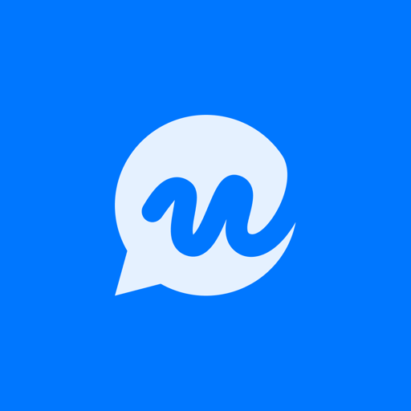

# Workchats MCP

Connect your AI assistant to [Workchats](https://www.workchats.com). It can catch you up on unread messages and mentions, search your conversations, manage tasks, summarise meetings, find files and draft replies. It works **as you**: it sees only what you can see, and it sends a message only after you approve the draft.

This repository holds client configuration only: a Gemini CLI extension, a Cursor plugin and setup steps. The server is hosted by Workchats at:

```
https://mcp.workchats.com/mcp
```

Use `https://mcp.workchats.com/mcp/readonly` for an assistant that can only read.

## Before you start

- You need a Workchats employee account. Guests cannot connect.
- A company admin must turn on **AI assistants** in the Workchats admin console.
- No API key is needed. The first time you connect, Workchats opens in your browser. Sign in, pick your company and click **Allow**.

## Install

### Cursor

[](https://cursor.com/link/mcp/install?name=workchats&config=eyJ1cmwiOiJodHRwczovL21jcC53b3JrY2hhdHMuY29tL21jcCJ9)

Or add this to `~/.cursor/mcp.json`, then sign in from **Settings → MCP**:

```json
{
  "mcpServers": {
    "workchats": { "url": "https://mcp.workchats.com/mcp" }
  }
}
```

### VS Code

[](https://insiders.vscode.dev/redirect/mcp/install?name=workchats&config=%7B%22type%22%3A%22http%22%2C%22url%22%3A%22https%3A%2F%2Fmcp.workchats.com%2Fmcp%22%7D)

### Claude Code

```bash
claude mcp add --transport http --scope user workchats https://mcp.workchats.com/mcp
```

Then run `/mcp`, choose `workchats` and sign in.

### Gemini CLI

```bash
gemini extensions install https://github.com/Octogle/workchats-mcp
```

Restart Gemini CLI and run `/mcp auth workchats`.

### Codex

```bash
codex mcp add workchats --url https://mcp.workchats.com/mcp
codex mcp login workchats
```

### Claude.ai and ChatGPT

Add a custom connector with the URL `https://mcp.workchats.com/mcp` and approve in Workchats.

## How sending works

The assistant never sends on its own. It writes a draft, which also appears in your Workchats message box. It sends only after you approve that draft, and the message shows that it was sent through the assistant.

## Disconnect

In Workchats, open **Settings → Connected AI apps** and click **Disconnect**.

## Documentation and support

- Docs: [developers.workchats.com/mcp/overview](https://developers.workchats.com/mcp/overview)
- Privacy: [static.workchats.com/privacy](https://static.workchats.com/privacy) · Terms: [static.workchats.com/terms](https://static.workchats.com/terms)
- Support: support@workchats.com

## Licence

The files in this repository are MIT licensed. The Workchats service is governed by its [terms](https://static.workchats.com/terms).
